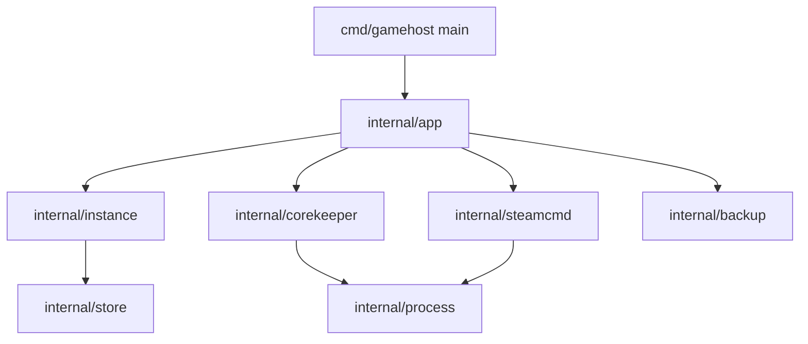

# gamehost

Terminal-first manager for dedicated game servers, written in Go. The first supported game is
**Core Keeper**: install, configure, run, log and back up a server for a small friend group.

The project is also a structured Go learning path: each milestone adds one real capability and the
language features it requires. See [docs/design.md](docs/design.md) for the full design, verified
Core Keeper launch contract, architecture and roadmap.

## Status

Early scaffold. `gamehost version` works; `doctor` and the rest of the roadmap are next (see the
milestone table in the design document).

## Requirements

- Go 1.26 or newer
- SteamCMD for installing game server files
- Linux with a writable data directory (`~/.local/share/gamehost` by default)

## Build and run

```bash
make build
./bin/gamehost version
```

```bash
make test   # go test -race ./...
make lint   # go vet ./...
make fmt    # gofmt -l -w .
```

## Layout

```
cmd/gamehost        command entry point
internal/app        argument parsing and command dispatch
internal/instance   domain model and validation
internal/store      config and state persistence
internal/process    process supervision
internal/corekeeper Core Keeper arguments and artifacts
internal/steamcmd   server installation and updates
internal/backup     snapshots of world data
internal/httpapi    HTTP API and UI (milestone M6)
docs/design.md      design, facts, roadmap
```

## Architecture


