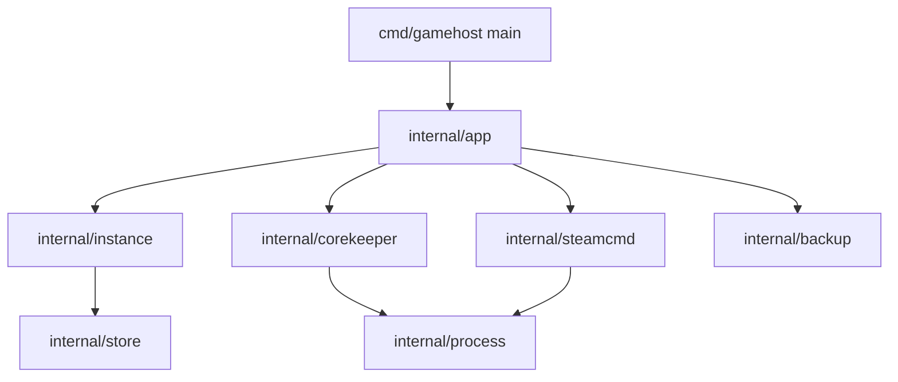

# gamehost

Terminal-first manager for dedicated game servers, written in Go. The first supported game is
**Core Keeper**: install, configure, run, log and back up a server for a small friend group.

The project is also a structured Go learning path: each milestone adds one real capability and the
language features it requires. See [docs/design.md](docs/design.md) for the full design, verified
Core Keeper launch contract, architecture and roadmap.

## Status

Milestones M0–M2 are done: `doctor` probes the environment, instances are created and persisted,
and `install`/`update` download the server files with SteamCMD.

```
$ gamehost doctor
root: /home/ramses/.local/share/gamehost

  ok  platform   linux/amd64
  ok  data root  /home/ramses/.local/share/gamehost
  ok  steamcmd   /home/ramses/.local/share/steamcmd/steamcmd.sh
  ok  display    :0

environment ready
```

## Usage

```bash
gamehost create corekeeper --max-players 5 --world-name "Cueva Compartida"
gamehost list
gamehost show corekeeper
gamehost install corekeeper
gamehost start corekeeper     # foreground, Ctrl+C stops it
gamehost status corekeeper    # from another terminal
```

`create` accepts flags before or after the instance name. Without `--port` the server uses the
Steam relay (no port forwarding); setting `--port` switches it to direct connections.

```
$ gamehost list
NAME        GAME        PLAYERS  NETWORK  WORLD
corekeeper  corekeeper  5        sdr      Cueva Compartida

$ gamehost status corekeeper
instance  corekeeper
phase     running
pid       4183021
uptime    1m20s
```

`start` runs the server in the foreground, tees its output to `logs/<timestamp>.log`, and records
the phase in `state.json`. Ctrl+C sends `SIGTERM` to the whole process group, waits up to 20
seconds, then escalates to `SIGKILL`.

## Requirements

- Go 1.26 or newer
- SteamCMD for installing game server files. `gamehost` looks for it in `GAMEHOST_STEAMCMD`, then
  `PATH`, then `~/.local/share/steamcmd/steamcmd.sh`.
- Linux with a writable data directory (`~/.local/share/gamehost` by default)

## Build and run

```bash
make build
./bin/gamehost version
```

```bash
make test   # go test -race ./...
make lint   # go vet ./...
make fmt    # gofmt -l -w .
```

## Layout

```
cmd/gamehost        command entry point
internal/app        argument parsing and command dispatch
internal/home       data directory resolution
internal/doctor     environment probes
internal/instance   domain model and validation
internal/store      config and state persistence
internal/process    process supervision
internal/corekeeper Core Keeper arguments and artifacts
internal/steamcmd   server installation and updates
internal/backup     snapshots of world data
internal/httpapi    HTTP API and UI (milestone M6)
docs/design.md      design, facts, roadmap
```

## Architecture


