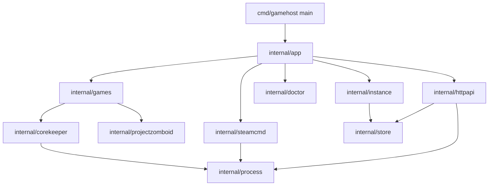
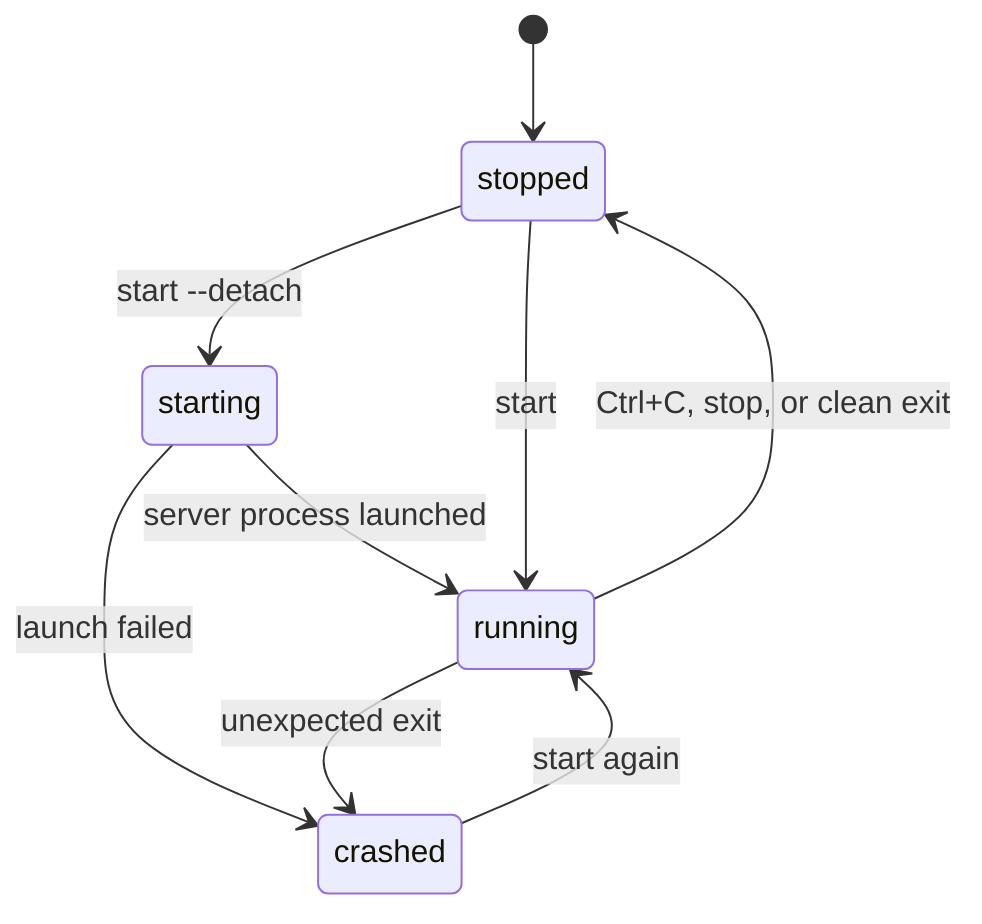

<!-- TODO(banner): uncomment and add the image at docs/assets/banner.png
<p align="center">
  
</p>
-->

# gamehost

[](https://github.com/SyberFoxx/gamehost/actions/workflows/ci.yml)

Terminal-first manager for dedicated game servers, written in Go. The first supported game is
**Core Keeper**: install, configure, run, inspect and back up a server for a small friend group.

The project is also a structured Go learning path. Every milestone adds one real capability and the
language features it requires: `os/exec`, process groups, signals, atomic writes, `net/http`,
concurrency and tests with `-race`.

<!-- TODO(screenshots): add docs/assets/screenshot-status.png and a short caption
<p align="center">
  
</p>
-->

## Status

| Milestone | Capability | State |
| --- | --- | --- |
| M0 | `doctor`: environment probes | done |
| M1 | `install` / `update`: SteamCMD downloads | done |
| M2 | `create` / `list` / `show`: instances on disk | done |
| M3 | `start` / `status`: process supervision, graceful shutdown | done |
| M3b | `start --detach` / `stop`: background supervision | done |
| M4 | `logs` / `logs -f`: tail and follow | done |
| M5 | `backup` / `restore` | done |
| M6 | `serve`: HTTP API and web panel | done |
| M7 | second game driver | done |

## Features

- Installs the dedicated server files with SteamCMD, anonymously, into an isolated directory.
- Keeps configuration and world data outside the repository, under a single `GAMEHOST_HOME` root.
- Validates the launch contract before touching a process: world mode names, game ID charset,
  player limits, network mode.
- Runs the server in the foreground or detached, with a clean `SIGTERM` → grace period → `SIGKILL`
  shutdown.
- Refuses a second server on the same world, and stops a detached one from any terminal.
- Persists the runtime phase so another terminal can see what is happening.
- Tees server output to both the terminal and a per-run log file.
- Archives the world into a compressed tar, prunes old copies and restores safely, keeping the
  previous data as a pre-restore backup.
- Serves a small web panel and a JSON API with live status, start/stop controls and an SSE log
  stream, embedding the page in the binary.
- Runs two games behind one driver interface: Core Keeper and Project Zomboid.

## Requirements

- Linux (the supervisor uses POSIX process groups and `/proc` to detect zombies)
- Go 1.26 or newer to build
- SteamCMD, looked up in this order: `GAMEHOST_STEAMCMD`, `PATH`,
  `~/.local/share/steamcmd/steamcmd.sh`
- A writable data directory, `~/.local/share/gamehost` by default

## Install

```bash
git clone https://github.com/SyberFoxx/gamehost.git
cd gamehost
make build
./bin/gamehost doctor
```

`doctor` checks the platform, the data directory, SteamCMD and the display, and exits non-zero when
the environment cannot run servers yet.

```
root: /home/ramses/.local/share/gamehost

  ok  platform   linux/amd64
  ok  data root  /home/ramses/.local/share/gamehost
  ok  steamcmd   /home/ramses/.local/share/steamcmd/steamcmd.sh
  ok  display    :0

environment ready
```

## Quick start

```bash
gamehost create corekeeper --max-players 5 --world-name "Cueva Compartida"
gamehost install corekeeper
gamehost start corekeeper --detach
```

```
corekeeper is running in the background (pid 326296)
  logs: /home/ramses/.local/share/gamehost/servers/corekeeper/logs/2026-11-04_14-01-14.log
  stop: gamehost stop corekeeper
```

In another terminal:

```bash
gamehost status corekeeper
gamehost list
gamehost logs corekeeper -f   # follow the server output
gamehost stop corekeeper
gamehost backup corekeeper    # archive the world
```

```
$ gamehost status corekeeper
instance  corekeeper
phase     running
pid       4183021
uptime    1m20s
game id   K85KQswu7GWLsQB
```

`status` reads the session id the server writes to `GameInfo.txt` next to its binary, so friends can
join with it. `start` records it in `state.json` when the run ends.

`start` without flags keeps the server in the foreground with its output on the terminal; Ctrl+C
stops it. `start --detach` hands the server to a supervisor in its own session and returns, so the
server survives closing the terminal. `stop` signals the whole process group, waits up to 20
seconds for a clean save, then escalates to `SIGKILL`.

Without `--port` the server uses the Steam relay network, so no router configuration is needed.
Passing `--port 27015` switches it to direct connections, which requires opening UDP ports.

A Project Zomboid server uses the same commands with `--game`:

```bash
gamehost create zomboid --game projectzomboid --world-name base --admin-password "cambia esto"
gamehost install zomboid
gamehost start zomboid --detach
```

Project Zomboid has no join code: `status` reports the UDP port to add in the Favorites tab, and
max players and the join password stay in `data/Server/base.ini`.

## Commands

| Command | Purpose |
| --- | --- |
| `gamehost doctor` | check platform, data directory, SteamCMD and display |
| `gamehost create <name> [flags]` | create an instance and its directories |
| `gamehost install <name>` | download the server files with SteamCMD |
| `gamehost update <name>` | back up the world, then re-download and validate the server files (stopped only) |
| `gamehost start <name> [--detach]` | run the server, in the foreground or in the background |
| `gamehost stop <name>` | stop a running server, waiting for a clean save |
| `gamehost logs <name> [-n N]` | print the last `N` lines (default 100) of the newest log |
| `gamehost logs <name> -f` | follow the log until Ctrl+C |
| `gamehost backup <name> [-keep N]` | archive `data/`, keeping the newest `N` (default 5) |
| `gamehost restore <name> <archive>` | replace `data/` from a backup, after saving the current one |
| `gamehost serve [--addr]` | serve the HTTP API and web panel (default `127.0.0.1:8080`) |
| `gamehost status <name>` | report phase, pid, uptime and join information |
| `gamehost list` | list instances |
| `gamehost show <name>` | print the full configuration of one instance |
| `gamehost version` | print the build version |

`create` flags:

| Flag | Default | Meaning |
| --- | --- | --- |
| `--game` | `corekeeper` | `corekeeper` or `projectzomboid` |
| `--max-players` | `8` | player limit, 1–8 (Core Keeper only) |
| `--world-name` | per game | world name, or the Project Zomboid server name (lowercase letters, digits, `-` and `_`) |
| `--seed` | random | world seed, only used on first creation (Core Keeper only) |
| `--mode` | `normal` | `normal`, `hard`, `creative` or `casual` (Core Keeper only) |
| `--port` | `0` | direct-connect port; `0` keeps the Steam relay (Core Keeper) or uses `16261` (Project Zomboid) |
| `--udp-port` | game port + 1 | Project Zomboid direct port (Project Zomboid only) |
| `--password` | none | join password, at most 28 characters (Core Keeper only) |
| `--admin-password` | required | Project Zomboid admin password (Project Zomboid only) |
| `--game-id` | generated | fixed game ID, 15–28 characters without `Y y x 0 O` (Core Keeper only) |

Flags work before or after the instance name.

## Web panel

```bash
gamehost serve
# serving http://127.0.0.1:8080
```

Open that address for a page with every instance, its phase and join id, start and stop buttons,
and a live log. The same data is available as JSON and server-sent events:

| Endpoint | Behavior |
| --- | --- |
| `GET /api/instances` | every instance with its resolved phase |
| `GET /api/instances/{name}` | one instance with its resolved phase |
| `POST /api/instances/{name}/start` | start in the background, return once it runs |
| `POST /api/instances/{name}/stop` | stop with the usual grace period |
| `GET /api/instances/{name}/logs?tail=N` | log stream as server-sent events (default 100 lines) |

```bash
curl -s http://127.0.0.1:8080/api/instances
curl -N http://127.0.0.1:8080/api/instances/corekeeper/logs?tail=50
```

The panel binds to loopback and has no authentication. Use `--addr` only behind a reverse proxy
that adds its own access control.

## How it works



| Package | Responsibility |
| --- | --- |
| `internal/app` | argument parsing, command dispatch, exit codes |
| `internal/instance` | domain model, defaults and invariants |
| `internal/store` | instance configuration and runtime state |
| `internal/atomicfile` | replace a file atomically, never leaving a partial copy |
| `internal/process` | process group, signals, grace period, exit codes |
| `internal/logs` | newest-log lookup, tail ring buffer, follow loop |
| `internal/game` | driver contracts: install args, launch, join, session id |
| `internal/games` | game name to driver registry |
| `internal/corekeeper` | Core Keeper launch arguments and join information |
| `internal/projectzomboid` | Project Zomboid install, launch and join information |
| `internal/steamcmd` | locating and running SteamCMD |
| `internal/doctor` | environment probes |
| `internal/httpapi` | JSON API, SSE log stream and embedded panel |
| `internal/home` | data directory resolution |

Server lifecycle:



`start` writes `state.json` before the process is reported as running, and again after it exits, so
`status` never has to guess. If a process disappears while `state.json` still says `running`,
`status` reports `crashed`.

Detached runs re-execute the same binary as a hidden `__supervise` command in a new session. The
supervisor owns the server process, records every phase change and outlives the terminal that
started it. `stop` signals the server's process group; the supervisor observes the exit and writes
the final state.

## Data layout

Everything mutable lives under `GAMEHOST_HOME` (default `~/.local/share/gamehost`):

```
servers/<name>/
├── instance.json     configuration
├── state.json        phase, pid, start time, last exit code
├── files/            SteamCMD install directory (the game server itself)
├── data/             -datapath: worlds/, ServerConfig.json, mods/, backups
├── logs/             one log file per run
└── backups/          <timestamp>.tar.gz and pre-restore_<timestamp>.tar.gz
```

The repository never contains generated data.

## Troubleshooting

| Symptom | Cause | Fix |
| --- | --- | --- |
| `doctor` reports `steamcmd not found` | SteamCMD is not on `PATH` | install the official tarball under `~/.local/share/steamcmd` or set `GAMEHOST_STEAMCMD` |
| `start` opens a window | the server initializes graphics even with `-batchmode` | keep the desktop session, or run it under Xvfb |
| `server is not installed` | `install` was never run | `gamehost install <name>` |
| SteamCMD exits 0 but nothing installed | SteamCMD reports failures in its output | `install` verifies the binary on disk and fails when it is missing |
| Assert dump after `stop` during startup | the world is still generating | wait for `Started session` in `gamehost logs -f` before stopping |
| Friends cannot join a Project Zomboid server | ports `16261` and `16262` stay UDP | forward both, and allow them in the firewall |
| `start-server.sh: Permission denied` | SteamCMD kept the script without the execute bit | `chmod +x files/start-server.sh` |
| `backup`, `restore` or `update` refuses to run | the server holds the world files | `gamehost stop <name>` first |
| `text file busy` in tests | `fork` inherits open write descriptors | do not run write-and-exec tests in parallel |

## Development

```bash
make build   # bin/gamehost
make test    # go test -race ./...
make lint    # go vet ./...
make fmt     # gofmt -l -w .
```

The full design, the verified Core Keeper launch contract and the decision log live in
[docs/design.md](docs/design.md). Working conventions for agents and contributors live in
[AGENTS.md](AGENTS.md).

## Design decisions

- **Native process over containers.** A container would outsource lifecycle, signals and I/O to the
  engine, which is exactly the part worth learning. A Podman backend can be added later behind the
  same `process` interface.
- **JSON configuration, no dependencies.** The standard library covers it and the CLI is the
  primary editor.
- **Foreground before daemon.** A visible process and a plain log file are easier to debug and test
  than a detached supervisor; `--detach` comes after the core is proven.
- **One root directory.** All mutable state under `GAMEHOST_HOME`, so the repository stays clean and
  backups are a single path.
- **Two games behind small interfaces.** `internal/game` holds `Installer` and `Runner`, and
  `internal/games` resolves a game name to its driver; the CLI and the API never switch on the game
  name to build a command line.

## License

MIT. See [LICENSE](LICENSE).
