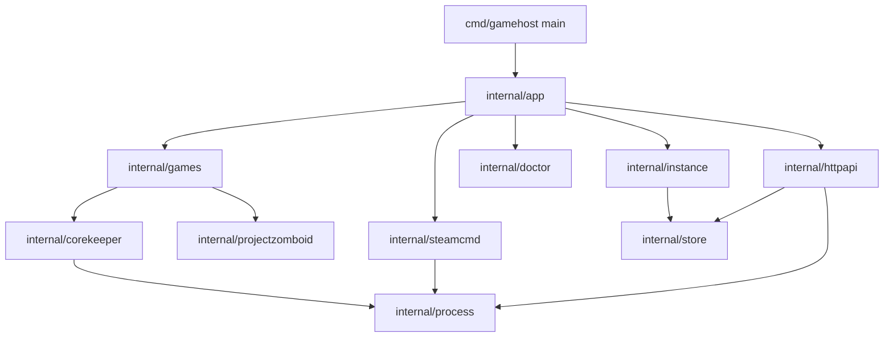
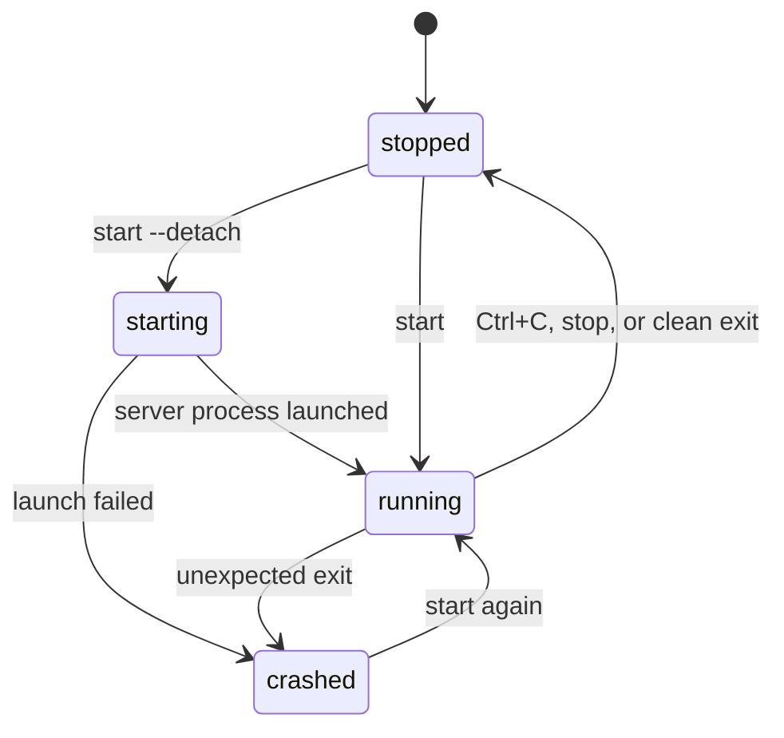

<!-- TODO(banner): uncomment and add the image at docs/assets/banner.png
<p align="center">
  
</p>
-->

# gamehost

[](https://github.com/SyberFoxx/gamehost/actions/workflows/ci.yml)

Terminal-first manager for dedicated game servers, written in Go. The first supported game is
**Core Keeper**: install, configure, run, inspect and back up a server for a small friend group.

The project is also a structured Go learning path. Every milestone adds one real capability and the
language features it requires: `os/exec`, process groups, signals, atomic writes, `net/http`,
concurrency and tests with `-race`.

<!-- TODO(screenshots): add docs/assets/screenshot-status.png and a short caption
<p align="center">
  
</p>
-->

## Status

| Milestone | Capability | State |
| --- | --- | --- |
| M0 | `doctor`: environment probes | done |
| M1 | `install` / `update`: SteamCMD downloads | done |
| M2 | `create` / `list` / `show`: instances on disk | done |
| M3 | `start` / `status`: process supervision, graceful shutdown | done |
| M3b | `start --detach` / `stop`: background supervision | done |
| M4 | `logs` / `logs -f`: tail and follow | done |
| M5 | `backup` / `restore` | done |
| M6 | `serve`: HTTP API and web panel | done |
| M7 | second game driver | done |
| M8 | operation: `import-world`, per-instance lock, log retention | done |
| M9 | `config`, API backups and scheduled backup windows | done |
| M10 | operators: `admin`, cross-site guard, `serve --start` | done |
| M11 | `service install` / `service uninstall`: systemd user units | done |
| M12 | interactive lobby: banner, arrow-key menu, log screen | done |
| M13 | lobby as the whole program: instances, files, backups, admins, systemd, panel | done |

## Features

- Installs the dedicated server files with SteamCMD, anonymously, into an isolated directory.
- Keeps configuration and world data outside the repository, under a single `GAMEHOST_HOME` root.
- Validates the launch contract before touching a process: world mode names, game ID charset,
  player limits, network mode.
- Runs the server in the foreground or detached, with a clean `SIGTERM` → grace period → `SIGKILL`
  shutdown.
- Refuses a second server on the same world, and stops a detached one from any terminal.
- Persists the runtime phase so another terminal can see what is happening.
- Tees server output to both the terminal and a per-run log file.
- Archives the world into a compressed tar, prunes old copies and restores safely, keeping the
  previous data as a pre-restore backup.
- Serves a small web panel and a JSON API with live status, start/stop controls and an SSE log
  stream, embedding the page in the binary.
- Runs two games behind one driver interface: Core Keeper and Project Zomboid.
- Imports an existing `.world.gzip` save into an instance, archiving the current world first.
- Holds a per-instance lock, so two servers or a backup and a start can never share one world.
- Keeps the newest ten run logs and prunes the rest.
- Changes the settings the launch flags express with `config`, without editing JSON by hand.
- Lists, creates and restores backups from the API and the panel, not only the terminal.
- Runs an opt-in backup window: `serve` owns it, or `service install` writes a systemd timer that
  stops, archives, prunes and starts the server again.
- Edits the Core Keeper admin list from the terminal, with Steam ID validation and the server's
  own file shape.
- Starts instances when the daemon boots, so one systemd unit brings the server back after a
  reboot.
- Writes its own systemd user units: the server with restart-on-crash, and a timer for the backup
  window. No hand-edited unit file.
- Rejects cross-site writes to the API: another page open in your browser cannot stop or restore a
  world.
- Opens an interactive lobby when you run `gamehost` with no arguments on a terminal: a large
  banner, the state of the selected world and a menu you drive with the arrow keys, for people who
  do not want to memorise commands.
- Reaches every command from that lobby, without typing a flag: create and edit an instance,
  install and update with live output, read and follow the log, list, create, restore and import
  worlds, manage admins, write or remove the systemd units, run `doctor` and start the web panel.

## Requirements

- Linux (the supervisor uses POSIX process groups and `/proc` to detect zombies)
- Go 1.26 or newer to build
- SteamCMD, looked up in this order: `GAMEHOST_STEAMCMD`, `PATH`,
  `~/.local/share/steamcmd/steamcmd.sh`
- A writable data directory, `~/.local/share/gamehost` by default

## Install

```bash
git clone https://github.com/SyberFoxx/gamehost.git
cd gamehost
make build
./bin/gamehost doctor
```

`doctor` checks the platform, the data directory, SteamCMD and the display, and exits non-zero when
the environment cannot run servers yet.

`bin/` is not installed system-wide. Call `./bin/gamehost` from the repository, or put it on the
PATH for the rest of the session:

```bash
export PATH="$PWD/bin:$PATH"
```

```
root: /home/ramses/.local/share/gamehost

  ok  platform   linux/amd64
  ok  data root  /home/ramses/.local/share/gamehost
  ok  steamcmd   /home/ramses/.local/share/steamcmd/steamcmd.sh
  ok  display    :0

environment ready
```

## Release binaries

Pushing a tag such as `v0.1.0` runs the release workflow: it tests, builds a static binary for
`linux/amd64` and `linux/arm64`, and publishes `gamehost_<tag>_linux_<arch>.tar.gz` with the
binary, this README and the license, plus `checksums.txt`.

```bash
tag=v0.1.0
curl -LO "https://github.com/SyberFoxx/gamehost/releases/download/${tag}/gamehost_${tag}_linux_amd64.tar.gz"
curl -LO "https://github.com/SyberFoxx/gamehost/releases/download/${tag}/checksums.txt"
sha256sum --check --ignore-missing checksums.txt
tar -xzf "gamehost_${tag}_linux_amd64.tar.gz"
mkdir -p ~/.local/bin
install -m 755 "gamehost_${tag}_linux_amd64/gamehost" ~/.local/bin/gamehost
```

The binary has no runtime dependencies: the build sets `CGO_ENABLED=0`, so it runs on any glibc or
musl distribution of that architecture.

## Lobby

Run `gamehost` with no arguments on a terminal and the lobby opens:

```text
 ██████╗   █████╗  ███╗   ███╗ ███████╗ ██╗  ██╗  ██████╗  ███████╗ ████████╗
██╔════╝  ██╔══██╗ ████╗ ████║ ██╔════╝ ██║  ██║ ██╔═══██╗ ██╔════╝ ╚══██╔══╝
██║  ███╗ ███████║ ██╔████╔██║ █████╗   ███████║ ██║   ██║ ███████╗    ██║
██║   ██║ ██╔══██║ ██║╚██╔╝██║ ██╔══╝   ██╔══██║ ██║   ██║ ╚════██║    ██║
╚██████╔╝ ██║  ██║ ██║ ╚═╝ ██║ ███████╗ ██║  ██║ ╚██████╔╝ ███████║    ██║
 ╚═════╝  ╚═╝  ╚═╝ ╚═╝     ╚═╝ ╚══════╝ ╚═╝  ╚═╝  ╚═════╝  ╚══════╝    ╚═╝

dedicated game servers without memorising flags

╭────────────────────────────────────────────────────────────────────╮
│ Partidita   Core Keeper                                            │
│ ● running   pid 733874   up 2h14m                                  │
│ game id K85KQswu7GWLsQB                                            │
╰────────────────────────────────────────────────────────────────────╯

› Start  run it in the background
  Stop
  Logs
  Backup
  Status
  Quit

↑↓ move    ↵ select    q quit
```

| Key | Action |
| --- | --- |
| `↑` `↓` or `k` `j` | move the cursor |
| `←` `→` or `h` `l` | switch instance, when there is more than one |
| `Enter` | run the selected action |
| `r` | reload the state |
| `Esc` | return from the log screen |
| `q` or `Ctrl+C` | leave |

```text
› Start  run it in the background
  Stop   wait for a clean save
  Logs   read and follow the newest log
  Backup archive the world now
INSTANCE
  Details phase, pid, join code, paths
  Settings world, players, network, backups
  Files install or update the server files
  Admins who can run admin commands
  Backups list, restore or import a world
  Systemd run it with systemd units
SYSTEM
  Environment check what the server needs
  Web panel serve the browser panel
  New instance create another world
  Quit leave the lobby
```

| Key | Action |
| --- | --- |
| `↑` `↓` or `k` `j` | move the cursor |
| `←` `→` or `h` `l` | switch instance, when there is more than one |
| `Enter` | open the selected screen or run the action |
| `n` | create an instance |
| `r` | reload the state |
| `?` | key map, with the command each action replaces |
| `Esc` | return to the previous screen |
| `q` or `Ctrl+C` | leave |

Every entry calls the same code as the command it names, so the lobby and the terminal can never
disagree about a phase or a grace period: `Start` uses the detached supervisor, `Stop` waits for the
clean save, `Backup` refuses a running server, `Logs` reads the newest file. A long action shows a
spinner and keeps the menu responsive; a failure is reported in the footer and the lobby stays
usable.

| Screen | What it does | Terminal equivalent |
| --- | --- | --- |
| New instance | wizard with the same validation; hides the fields the chosen game does not use | `create` |
| Details | read-only view of the configuration and the state | `show`, `status` |
| Settings | edits the values the launch flags read; refuses while the server runs | `config` |
| Files | install or update, streaming the SteamCMD output; `Esc` cancels the download | `install`, `update` |
| Logs | newest tail, then follows live; `G` returns to the live edge | `logs -f` |
| Backups | `b` archives, `Enter` restores, `i` imports a `.world.gzip` | `backup`, `restore`, `import-world` |
| Admins | `a` adds, `d` removes, both only while stopped | `admin add`, `admin remove` |
| Systemd | `i` writes the units, `e` also enables them, `u` removes them | `service install`, `service uninstall` |
| Environment | every `doctor` check with its status and a verdict | `doctor` |
| Web panel | starts the panel on `127.0.0.1:8080` and stops it on `Esc` | `serve` |

Destructive actions ask first: stop, update, restore, import, uninstall and remove-admin show a
dialog naming the instance and what will happen. The web panel dies with the lobby.

The lobby only opens when both stdin and stdout are terminals. `gamehost | head`, a redirect or a
script still gets the usage text and exit code 2, which is what the systemd units and the HTTP API
rely on.

## Quick start

```bash
gamehost create corekeeper --max-players 5 --world-name "Cueva Compartida"
gamehost install corekeeper
gamehost start corekeeper --detach
```

```
corekeeper is running in the background (pid 326296)
  logs: /home/ramses/.local/share/gamehost/servers/corekeeper/logs/2026-11-04_14-01-14.log
  stop: gamehost stop corekeeper
```

In another terminal:

```bash
gamehost status corekeeper
gamehost list
gamehost logs corekeeper -f   # follow the server output
gamehost stop corekeeper
gamehost backup corekeeper    # archive the world
```

```
$ gamehost status corekeeper
instance  corekeeper
phase     running
pid       4183021
uptime    1m20s
game id   K85KQswu7GWLsQB
```

`status` reads the session id the server writes to `GameInfo.txt` next to its binary, so friends can
join with it. `start` records it in `state.json` when the run ends.

`config` prints the settings with no flags and changes them with flags:

```bash
gamehost config corekeeper                     # print what the launcher will use
gamehost config corekeeper --max-players 5 --backup-every 24h
```

It refuses while the server runs, because the server reads these values at launch. The world index
is fixed after creation; `--world-name` only changes the label players see, not the save. The seed
matters while a world is generated, so changing it on an existing save does nothing. For Project
Zomboid, max players and the join password stay in its ini.

`start` without flags keeps the server in the foreground with its output on the terminal; Ctrl+C
stops it. `start --detach` hands the server to a supervisor in its own session and returns, so the
server survives closing the terminal. `stop` signals the whole process group, waits up to 20
seconds for a clean save, then escalates to `SIGKILL`.

Without `--port` the server uses the Steam relay network, so no router configuration is needed.
Passing `--port 27015` switches it to direct connections, which requires opening UDP ports.

### Scheduled backups

A backup needs a stopped server, so a schedule is a maintenance window. Two owners can run it:

- `gamehost serve` owns the daemon, the panel and the window itself.
- `gamehost service install` writes a systemd timer that runs the window, so nothing has to stay in
  a terminal.

```bash
gamehost config corekeeper --backup-every 24h --backup-keep 5
gamehost service install corekeeper --enable
```

When the interval elapses, the timer stops the server, writes `backups/<timestamp>.tar.gz`, prunes
archives beyond the retention and starts the server again. A stopped server is only archived; a
failed archive never leaves the server down because the restart runs in `ExecStopPost`.
`--backup-every off` plus another `service install` removes the timer. Use one owner per instance:
a systemd timer and `serve --start` on the same instance would fight over one server.

### Admins

The server keeps its admin list in `data/Admins.json` and rewrites it on exit, so edit it with the
server stopped:

```bash
gamehost stop corekeeper
gamehost admin add corekeeper 76561198012345678 --name "Ramsés"
gamehost admin add corekeeper 76561198012345679 --name "Amigo" --limited
gamehost admin list corekeeper
gamehost admin remove corekeeper 76561198012345679
gamehost start corekeeper --detach
```

A Steam ID64 is the 17-digit number that starts with `7656119`. `full` (privileges `2`) can use
every admin command; `--limited` stores privileges `1`, the level the game marks as limited.
`admin list` works while the server runs; `add` and `remove` refuse until it is stopped.

### Running it as a systemd user service

`start --detach` survives closing the terminal, not a reboot. `service install` writes the units
that own it: the server, plus a timer for the backup window when one is configured.

```bash
cd ~/proyectos/gamehost
make build
./bin/gamehost service install corekeeper --enable
```

```
wrote /home/ramses/.config/systemd/user/gamehost-corekeeper.service
wrote /home/ramses/.config/systemd/user/gamehost-corekeeper-backup.service
wrote /home/ramses/.config/systemd/user/gamehost-corekeeper-backup.timer

started gamehost-corekeeper.service
backup every 24h, keeping 5 archives
logs: journalctl --user -u gamehost-corekeeper -f
```

`--enable` runs `daemon-reload`, enables the units and starts them. If the server is already
running outside systemd, it only enables the unit and prints the two commands that hand it over:
it never kills a server you started by hand. Without `--enable` it only writes the files.

The main unit runs `gamehost start <name>` in the foreground with `Restart=on-failure` and
`KillMode=mixed`, so systemd restarts a crash after five seconds and lets gamehost save before the
30-second stop timeout. The backup unit stops the server, archives it and starts it again; the
restart lives in `ExecStopPost`, so a failed archive still brings the server back.

Core Keeper opens a window even with `-batchmode`. The unit exports the `DISPLAY` it was installed
from, so it starts while that graphical session exists. For a headless boot, install `xvfb`, run a
virtual display and install the unit against it:

```bash
Xvfb :99 -screen 0 1024x768x24 &
DISPLAY=:99 ./bin/gamehost service install corekeeper --enable
```

```bash
systemctl --user status gamehost-corekeeper.service
journalctl --user -u gamehost-corekeeper -f   # server output; the run log stays in the instance
systemctl --user list-timers 'gamehost-*'
./bin/gamehost service uninstall corekeeper    # disable, stop and remove the units
```

User units start at boot only after you enable lingering:

```bash
loginctl enable-linger "$USER"
```

`service install` reads `--backup-every` and `--backup-keep` from the instance. Run it again after
changing the schedule or moving the binary (`--binary PATH`).

### Importing an existing world

A world created in single player, or copied from another server, can be dropped into an instance:

```bash
gamehost stop corekeeper
gamehost import-world corekeeper ~/Descargas/Cueva.world.gzip
gamehost start corekeeper --detach
```

`import-world` accepts any non-empty `.world.gzip` file, archives the current `data/` when it is
not empty, and copies the save into the instance's slot (the `world` index shown by
`gamehost show`). Client saves live in
`~/.config/unity3d/Pugstorm/Core Keeper/Steam/<steam-id>/worlds/<slot>.world.gzip`. Despite the
name, current Core Keeper saves are not plain gzip streams, so the server decides whether a save
is valid; the pre-import archive is the way back.

The imported save loads in the instance's world slot and takes its name from the instance. Rename it
with the server stopped:

```bash
gamehost config corekeeper --world-name Partidita
```

A Project Zomboid server uses the same commands with `--game`:

```bash
gamehost create zomboid --game projectzomboid --world-name base --admin-password "cambia esto"
gamehost install zomboid
gamehost start zomboid --detach
```

Project Zomboid has no join code: `status` reports the UDP port to add in the Favorites tab, and
max players and the join password stay in `data/Server/base.ini`.

## Verifying a real Core Keeper server

The test suite stops at the SteamCMD download. Once per machine, walk the whole path:

1. `gamehost doctor` reports every check `ok`.
2. `gamehost create corekeeper --max-players 4 --password change-me`.
3. `gamehost install corekeeper` ends with the binary path and no SteamCMD error.
4. `gamehost start corekeeper --detach`, then `gamehost logs corekeeper -f` until the session
   starts.
5. Join with the id from `gamehost status corekeeper`, play a minute so the world saves.
6. `gamehost stop corekeeper` prints one stopped line with exit `0`, not a signal.
7. `gamehost backup corekeeper` writes an archive whose size grows with the world.
8. Move `data/worlds/0.world.gzip` away, `gamehost restore corekeeper <archive>` and start again:
   the world is back with its builds.

## Commands

| Command | Purpose |
| --- | --- |
| `gamehost` | open the interactive lobby: every command below is also a screen (terminal only) |
| `gamehost doctor` | check platform, data directory, SteamCMD and display |
| `gamehost create <name> [flags]` | create an instance and its directories |
| `gamehost config <name> [flags]` | print or change the settings the launch flags express (stopped only) |
| `gamehost install <name>` | download the server files with SteamCMD |
| `gamehost update <name>` | back up the world, then re-download and validate the server files (stopped only) |
| `gamehost start <name> [--detach]` | run the server, in the foreground or in the background |
| `gamehost stop <name>` | stop a running server, waiting for a clean save |
| `gamehost logs <name> [-n N]` | print the last `N` lines (default 100) of the newest log |
| `gamehost logs <name> -f` | follow the log until Ctrl+C |
| `gamehost import-world <name> <file>` | copy an existing `.world.gzip` save into the instance slot (stopped only) |
| `gamehost backup <name> [-keep N]` | archive `data/`, keeping the newest `N` (default 5) |
| `gamehost restore <name> <archive>` | replace `data/` from a backup, after saving the current one |
| `gamehost admin list <name>` | print the admins stored in `data/Admins.json` |
| `gamehost admin add <name> <steamid> [--name NAME] [--limited]` | grant admin rights (stopped only) |
| `gamehost admin remove <name> <steamid>` | drop admin rights (stopped only) |
| `gamehost serve [--addr]` | serve the HTTP API and web panel (default `127.0.0.1:8080`) |
| `gamehost serve --start <name>` | start that instance when the daemon boots; repeatable |
| `gamehost service install <name> [--enable]` | write the systemd user units, optionally enabling and starting them |
| `gamehost service uninstall <name>` | disable, stop and remove those units |
| `gamehost status <name>` | report phase, pid, uptime and join information |
| `gamehost list` | list instances |
| `gamehost show <name>` | print the full configuration of one instance |
| `gamehost version` | print the build version |

`create` flags:

| Flag | Default | Meaning |
| --- | --- | --- |
| `--game` | `corekeeper` | `corekeeper` or `projectzomboid` |
| `--max-players` | `8` | player limit, 1–8 (Core Keeper only) |
| `--world-name` | per game | world name, or the Project Zomboid server name (lowercase letters, digits, `-` and `_`) |
| `--seed` | random | world seed, only used on first creation (Core Keeper only) |
| `--mode` | `normal` | `normal`, `hard`, `creative` or `casual` (Core Keeper only) |
| `--port` | `0` | direct-connect port; `0` keeps the Steam relay (Core Keeper) or uses `16261` (Project Zomboid) |
| `--udp-port` | game port + 1 | Project Zomboid direct port (Project Zomboid only) |
| `--password` | none | join password, at most 28 characters (Core Keeper only) |
| `--admin-password` | required | Project Zomboid admin password (Project Zomboid only) |
| `--game-id` | generated | fixed game ID, 15–28 characters without `Y y x 0 O` (Core Keeper only) |
| `--backup-every` | off | scheduled backup interval such as `24h`; needs `gamehost serve` running |
| `--backup-keep` | `5` | scheduled archives to keep, oldest removed first |

Flags work before or after the instance name.

## Web panel

```bash
gamehost serve
# serving http://127.0.0.1:8080
```

Open that address for a page with every instance, its phase and join id, start, stop, backup and
restore controls, and a live log. The same data is available as JSON and server-sent events:

| Endpoint | Behavior |
| --- | --- |
| `GET /api/instances` | every instance with its resolved phase |
| `GET /api/instances/{name}` | one instance with its resolved phase |
| `POST /api/instances/{name}/start` | start in the background, return once it runs |
| `POST /api/instances/{name}/stop` | stop with the usual grace period |
| `GET /api/instances/{name}/logs?tail=N` | log stream as server-sent events (default 100 lines) |
| `GET /api/instances/{name}/backups` | archives in `backups/`, newest first |
| `POST /api/instances/{name}/backup` | archive `data/`, applying the default retention of 5 |
| `POST /api/instances/{name}/restore` | restore one archive named in the JSON body, stopped only |

```bash
curl -s http://127.0.0.1:8080/api/instances
curl -N http://127.0.0.1:8080/api/instances/corekeeper/logs?tail=50
```

The panel binds to loopback and has no authentication. Use `--addr` only behind a reverse proxy
that adds its own access control.

## How it works



| Package | Responsibility |
| --- | --- |
| `internal/app` | argument parsing, command dispatch, exit codes |
| `internal/instance` | domain model, defaults and invariants |
| `internal/store` | instance configuration and runtime state |
| `internal/atomicfile` | replace a file atomically, never leaving a partial copy |
| `internal/process` | process group, signals, grace period, exit codes |
| `internal/logs` | newest-log lookup, tail ring buffer, follow loop |
| `internal/game` | driver contracts: install args, launch, join, session id |
| `internal/games` | game name to driver registry |
| `internal/corekeeper` | Core Keeper launch arguments and join information |
| `internal/projectzomboid` | Project Zomboid install, launch and join information |
| `internal/steamcmd` | locating and running SteamCMD |
| `internal/doctor` | environment probes |
| `internal/httpapi` | JSON API, SSE log stream and embedded panel |
| `internal/home` | data directory resolution |

Server lifecycle:



`start` writes `state.json` before the process is reported as running, and again after it exits, so
`status` never has to guess. If a process disappears while `state.json` still says `running`,
`status` reports `crashed`.

Detached runs re-execute the same binary as a hidden `__supervise` command in a new session. The
supervisor owns the server process, records every phase change and outlives the terminal that
started it. `stop` signals the server's process group; the supervisor observes the exit and writes
the final state.

`serve` is also the backup daemon: it re-reads the instances every 30 seconds, finds the ones whose
window elapsed and drives stop, archive, prune and start through the same helpers the CLI uses.

## Data layout

Everything mutable lives under `GAMEHOST_HOME` (default `~/.local/share/gamehost`):

```
servers/<name>/
├── instance.json     configuration
├── state.json        phase, pid, start time, last exit code
├── files/            SteamCMD install directory (the game server itself)
├── data/             -datapath: worlds/, ServerConfig.json, mods/, backups
├── logs/             one log file per run, newest ten kept
├── backups/          <timestamp>.tar.gz, pre-restore_<timestamp>.tar.gz
└── run.lock          held by the running server or a data command (flock)
```

The repository never contains generated data.

## Troubleshooting

| Symptom | Cause | Fix |
| --- | --- | --- |
| `doctor` reports `steamcmd not found` | SteamCMD is not on `PATH` | install the official tarball under `~/.local/share/steamcmd` or set `GAMEHOST_STEAMCMD` |
| `start` opens a window | the server initializes graphics even with `-batchmode` | keep the desktop session, or run it under Xvfb |
| `server is not installed` | `install` was never run | `gamehost install <name>` |
| SteamCMD exits 0 but nothing installed | SteamCMD reports failures in its output | `install` verifies the binary on disk and fails when it is missing |
| Assert dump after `stop` during startup | the world is still generating | wait for `Started session` in `gamehost logs -f` before stopping |
| Friends cannot join a Project Zomboid server | ports `16261` and `16262` stay UDP | forward both, and allow them in the firewall |
| `start-server.sh: Permission denied` | SteamCMD kept the script without the execute bit | `chmod +x files/start-server.sh` |
| `backup`, `restore` or `update` refuses to run | the server holds the world files | `gamehost stop <name>` first |
| `instance is already running` or `instance is in use by another gamehost command` | the server, or a command between its check and its state write, holds `run.lock` | wait for it, or `gamehost stop <name>` if a server was left behind |
| A scheduled backup never runs | `serve` is not running, or the interval has not elapsed since the newest archive | keep `gamehost serve` running and watch its output |
| The server restarted by itself | a scheduled backup window stopped it to archive a consistent world | raise or disable `--backup-every` |
| `text file busy` in tests | `fork` inherits open write descriptors | do not run write-and-exec tests in parallel |

## Development

```bash
make build   # bin/gamehost
make test    # go test -race ./...
make lint    # go vet ./...
make fmt     # gofmt -l -w .
```

The full design, the verified Core Keeper launch contract and the decision log live in
[docs/design.md](docs/design.md). Working conventions for agents and contributors live in
[AGENTS.md](AGENTS.md).

## Design decisions

- **Native process over containers.** A container would outsource lifecycle, signals and I/O to the
  engine, which is exactly the part worth learning. A Podman backend can be added later behind the
  same `process` interface.
- **JSON configuration, no dependencies.** The standard library covers it and the CLI is the
  primary editor.
- **Foreground before daemon.** A visible process and a plain log file are easier to debug and test
  than a detached supervisor; `--detach` comes after the core is proven.
- **One root directory.** All mutable state under `GAMEHOST_HOME`, so the repository stays clean and
  backups are a single path.
- **Two games behind small interfaces.** `internal/game` holds `Installer` and `Runner`, and
  `internal/games` resolves a game name to its driver; the CLI and the API never switch on the game
  name to build a command line.
- **Configuration only edits what a flag can express.** `config` rewrites `instance.json` and leaves
  `ServerConfig.json`, the ini and the game ID file to the server, so it cannot invent a schema it
  does not own. The world name and seed stay immutable because the save already exists.
- **A schedule is a maintenance window.** Backups are only consistent with the world closed, so a
  due backup stops the server, archives, prunes and starts it again. Either `serve` owns that loop,
  or `service install` writes a systemd timer that does; the restart lives in `ExecStopPost` so a
  failed archive still brings the server back. Two owners on one instance are a configuration
  error, not a feature.
- **Units are rendered, not executed.** `internal/service` only returns file content, so the unit
  layout is tested with `t.TempDir()` and no systemd; the CLI is the only place that runs
  `systemctl`. Paths are quoted, `%` and `$` are escaped, and the unit uses `KillMode=mixed` so
  gamehost, not systemd, owns the game's shutdown.
- **The admin list belongs to the server.** Core Keeper rewrites `Admins.json` on exit, so `admin`
  only edits it while stopped, writes it atomically in the server's own shape and renumbers the
  entries; the manager never keeps a second copy.
- **The panel only accepts same-origin writes.** A state-changing request must carry an `Origin`
  that matches the host that served the page, or no browser headers at all like a CLI client, and
  never `Sec-Fetch-Site: cross-site`. Reads stay open: a stray link cannot stop a world.

## License

MIT. See [LICENSE](LICENSE).
