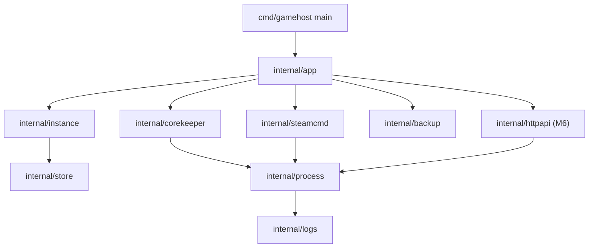
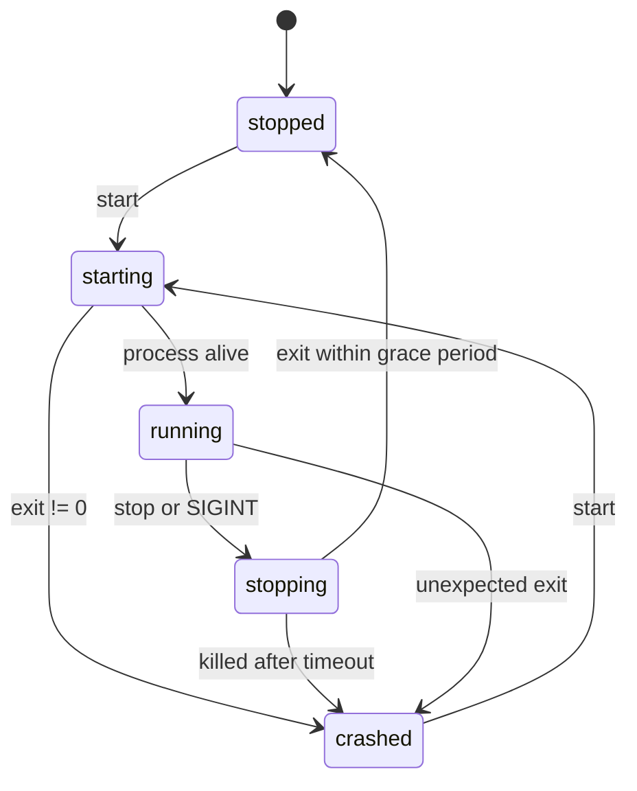

# gamehost — design

A terminal-first manager for dedicated game servers, written in Go, starting with **Core Keeper**.

The project doubles as a learning vehicle: every milestone introduces a Go concept that a real
program needs (process control, signals, concurrency, `net/http`, tests with `-race`), instead of
synthetic exercises.

## 1. Goals and non-goals

**Goals (MVP)**

- Install and update a Core Keeper dedicated server with SteamCMD.
- Create and manage server instances (world name, seed, mode, player limit, network mode).
- Start, stop and inspect a server process reliably, with graceful shutdown.
- Stream and follow the server log.
- Back up and restore world data.
- Keep the code idiomatic: small packages, explicit errors, no hidden global state.

**Non-goals (for now)**

- Docker or Podman orchestration.
- Mod management (mod.io).
- Discord webhooks, metrics, scheduled jobs.
- A second game driver, TUI or web UI before the Core Keeper CLI is solid.

## 2. Verified facts about the Core Keeper dedicated server

Source: [`escapingnetwork/core-keeper-dedicated`](https://github.com/escapingnetwork/core-keeper-dedicated)
(the widely used container image), which encodes the real launch contract of the Linux server.

| Fact | Value |
| --- | --- |
| Dedicated server Steam app | `1963720` |
| Companion app installed by the image | `1007` (Steam client libraries, loaded from `steamcmd/linux64`) |
| Steam login | `anonymous` |
| Binary | `CoreKeeperServer` in the install directory, run with that directory as cwd |
| Game ID file | `GameID.txt` written next to the binary; `GameInfo.txt` also appears |
| World data | directory passed with `-datapath`, separate from program files |
| Player count | store copy says 1–8 players; the image defaults `MAX_PLAYERS=10` |

Launch flags (all optional, space-separated):

```
-batchmode -logfile <path> -world <index> -worldname <name> -worldseed <seed>
-worldmode <0|1|2|4> -hashedworldseed <hash> -gameid <id> -datapath <dir>
-maxplayers <n> -season <n> -ip <addr> -port <port> -password <pw>
-allowonlyplatform <1|2|3|4> -activatecontent <list> -activateallcontent
```

World modes: normal `0`, hard `1`, creative `2`, casual `4`.
Game ID: 15–28 alphanumeric characters; empty means the server generates one and writes `GameID.txt`.

Network modes:

- **SDR** (no `-port`): traffic goes through Steam relay, no port forwarding. Default for a small
  friend group.
- **Direct connect** (`-port` set): lower latency, requires opening and forwarding UDP ports.

Open questions to validate empirically in M1/M3:

1. Whether app `1007` must land in the install directory or only in the SteamCMD `linux64` folder,
   and what `LD_LIBRARY_PATH` the native binary needs.
2. Whether the native binary really needs an X display with `-batchmode` (the image runs Xvfb; this
   workstation has `DISPLAY=:0`, so it should not).
3. Exact on-disk layout inside `-datapath` (backups tar the whole directory either way).

## 3. Architecture



| Package | Responsibility | Introduced |
| --- | --- | --- |
| `internal/app` | parse args, dispatch commands, own exit codes | M0 |
| `internal/store` | load/save instance config and runtime state (JSON, atomic write) | M2 |
| `internal/instance` | domain model and validation | M2 |
| `internal/process` | supervise one OS process: start, signal, wait, state | M3 |
| `internal/logs` | log file plus in-memory ring buffer and subscribers | M4 |
| `internal/corekeeper` | translate an instance into `CoreKeeperServer` args, read `GameID.txt` | M3 |
| `internal/steamcmd` | install/update app `1963720` and validate the binary | M1 |
| `internal/backup` | tar.gz snapshots of the data directory with retention | M5 |
| `internal/httpapi` | HTTP API plus SSE log stream and embedded UI | M6 |

Rules that keep the project idiomatic:

- Interfaces are declared where they are consumed and stay at 1–3 methods.
- Constructors take dependencies, return concrete types.
- `context.Context` first parameter on anything that blocks or does I/O.
- Errors are wrapped with `%w` and the operation that failed.
- No `init`, no mutable package-level state; the config root is injected.

## 4. Domain model

```go
type Instance struct {
    Name       string
    Game       string // "corekeeper"
    InstallDir string
    DataDir    string
    World      World
    Network    Network
    MaxPlayers int
    GameID     string
}

type World struct {
    Index int
    Name  string
    Seed  string
    Mode  string // normal | hard | creative | casual
}

type Network struct {
    Mode     string // sdr | direct
    Port     int
    Password string
}
```

Runtime state is separate from configuration, so a crashed server never corrupts the config:

```go
type State struct {
    Phase     Phase     // stopped | starting | running | stopping | crashed
    PID       int
    StartedAt time.Time
    ExitCode  int
    GameID    string
}
```



## 5. Runtime layout

Single root, overridable with `GAMEHOST_HOME`:

```
$XDG_DATA_HOME/gamehost/            default ~/.local/share/gamehost
└── servers/<name>/
    ├── instance.json               user configuration
    ├── state.json                  runtime state, rewritten on every transition
    ├── files/                      SteamCMD install dir (-force_install_dir)
    ├── data/                       -datapath, holds worlds
    ├── logs/<timestamp>.log        one file per run
    └── backups/<timestamp>.tar.gz
```

Nothing generated by the manager lives inside the git repository.

## 6. Command line

| Command | Behavior | Milestone |
| --- | --- | --- |
| `gamehost version` | print build version | M0 |
| `gamehost doctor` | check SteamCMD, write permissions, disk space, display | M0 |
| `gamehost install <name>` | create instance if needed and download app `1963720` | M1 |
| `gamehost update <name>` | SteamCMD `app_update ... validate` | M1 |
| `gamehost create <name>` | write `instance.json` from flags | M2 |
| `gamehost list` | table of instances and phases | M2 |
| `gamehost show <name>` | config plus last known state | M2 |
| `gamehost start <name>` | run in foreground, log to stdout and file; Ctrl+C stops | M3 |
| `gamehost start <name> --detach` | re-exec a supervisor child, log to file only | M3b |
| `gamehost status <name>` | phase, pid, uptime, game ID | M3 |
| `gamehost stop <name>` | SIGTERM, wait grace period, SIGKILL | M3b |
| `gamehost logs <name> [-f]` | tail or follow the current log | M4 |
| `gamehost backup <name>` | snapshot `data/`, apply retention | M5 |
| `gamehost restore <name> <archive>` | restore after confirmation | M5 |
| `gamehost serve [--addr]` | HTTP API and UI | M6 |

`start` runs in the foreground first on purpose: one process, one log stream, no PID guessing.
The detached supervisor is a separate milestone because it is the hardest concurrency problem in
the project and deserves its own design and tests.

## 7. Milestones

| # | Deliverable | Acceptance | Go concepts |
| --- | --- | --- | --- |
| M0 | skeleton, `version`, `doctor` | `go build`, `go test -race`, `doctor` reports missing SteamCMD on this machine | packages, `io.Writer` injection, error wrapping, table tests |
| M1 | `install`, `update` | server binary and Steam libs present, update is idempotent | `os/exec`, pipes, context cancellation, exit codes |
| M2 | `create`, `list`, `show` | validation rejects bad names, ports and player counts; config survives restart | structs, JSON, atomic writes, `t.TempDir` |
| M3 | `start`, `status`, `stop` | foreground run, SIGINT shutdown, crashed state detected after `kill -9` | process groups, signals, `exec.Cmd`, timeouts |
| M3b | `--detach` | `start` returns, `status` sees the server, no orphan processes | re-exec, `Setsid`, file locking |
| M4 | `logs` | `-f` follows live output without losing lines | `bufio.Scanner`, ring buffer, channels |
| M5 | `backup`, `restore` | archive restores into a working world | `archive/tar`, `compress/gzip`, `filepath.WalkDir` |
| M6 | `serve` | start/stop/status from the browser, live log via SSE | `net/http`, `Server.Shutdown`, `embed` |
| M7 | second game driver | `game.Driver` interface with two implementations | interfaces at the consumer, plugin-style layout |

Each milestone is one work unit: code, tests and doc updates in the same commit.

## 8. Testing strategy

- Table-driven tests, `t.Run`, `t.Parallel` where there is no shared state.
- Always `go test -race ./...`.
- Filesystem tests use `t.TempDir()`; no test writes into the repository.
- External processes are replaced by small hand-written fakes behind a 1–3 method interface.
- `steamcmd` and the real server are exercised by a manual checklist, not by the default test
  suite; anything network or multi-gigabyte gets a `//go:build integration` tag.
- `doctor` is the first command because it makes the environment explicit and testable.

## 9. Risks

| Risk | Mitigation |
| --- | --- |
| SteamCMD not installed on Nobara (checked: absent) | `doctor` explains the two install paths; M1 documents the working one |
| Native server needs libraries from app `1007` | validate `LD_LIBRARY_PATH` in M1 before writing the supervisor |
| Server needs a display despite `-batchmode` | M3 smoke test; fall back to Xvfb only if proven necessary |
| Hosting and playing on the same machine | measure RAM/CPU during a 5-player session; `status` reports resource hints later |
| Direct-connect mode requires router changes | default to SDR (no `-port`) |
| Save corruption from hard kills | graceful stop with timeout, backup before update |

## 10. Decisions

- **Native process over containers.** Podman would outsource lifecycle, signals and I/O to the
  engine, which is exactly the part worth learning in Go. A container backend can be added later
  behind the same `process` interface.
- **JSON config, no dependency.** The standard library covers it; the CLI is the primary editor.
  TOML would add a dependency before it earns its place.
- **Foreground before daemon.** A visible process and a plain log file are easier to debug and to
  test than a detached supervisor.
- **One root directory.** All mutable state under `GAMEHOST_HOME`, so the repository stays clean
  and backups are a single path.
