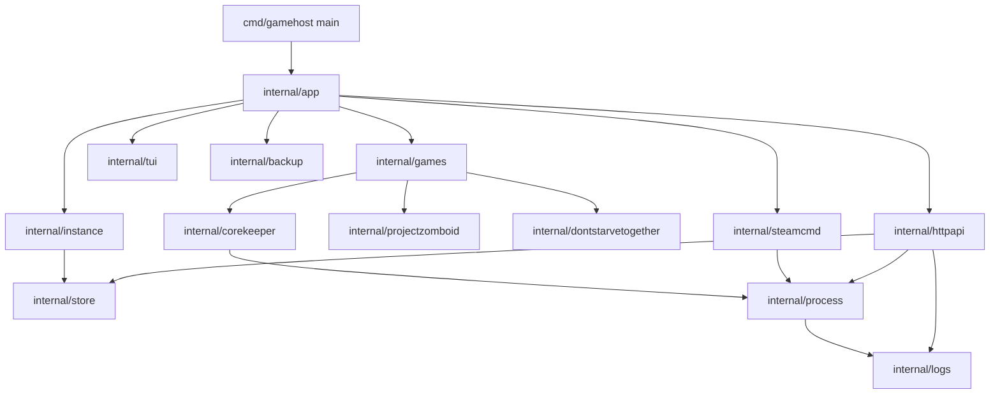
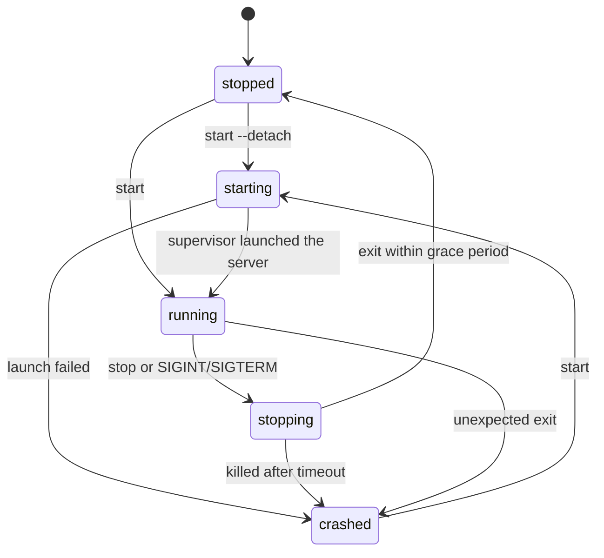

# gamehost — design

A terminal-first manager for dedicated game servers, written in Go, starting with **Core Keeper**,
**Project Zomboid** and **Don't Starve Together**.

The project doubles as a learning vehicle: every milestone introduces a Go concept that a real
program needs (process control, signals, concurrency, `net/http`, tests with `-race`), instead of
synthetic exercises.

**Status:** M0–M14 implemented (`doctor`, instance model and store, `install`/`update`,
`start`/`status` with join information, `start --detach`, `stop`, `logs`/`logs -f`,
`backup`/`restore`, `serve` with the HTTP API and panel, two more game drivers, `import-world`,
the per-instance lock, `config`, API backups, scheduled backup windows, and the lobby that reaches
every one of them).

## 1. Goals and non-goals

**Goals (MVP)**

- Install and update a Core Keeper dedicated server with SteamCMD.
- Create and manage server instances (world name, seed, mode, player limit, network mode).
- Start, stop and inspect a server process reliably, with graceful shutdown.
- Stream and follow the server log.
- Back up and restore world data.
- Reach every capability from a didactic lobby for people who do not live in a terminal, without
  removing the commands that scripts and services depend on.
- Keep the code idiomatic: small packages, explicit errors, no hidden global state.

**Non-goals (for now)**

- Docker or Podman orchestration.
- Mod management (mod.io).
- Discord webhooks and metrics. Scheduled jobs are limited to the backup window described below.
- A third game driver before the first two are solid.
- A mouse-driven UI. The lobby is keyboard-only; a terminal multiplexer that sends clicks does not
  need a second interaction model.
- The lobby replacing the non-interactive commands. Scripts, systemd units and the HTTP API keep
  the flags and the exit codes they already had.

## 2. Verified facts about the supported games

### Core Keeper

Primary source: the `ARGUMENTS.txt` and launch scripts shipped **inside the game files**
(`CoreKeeperServer` install directory), which are authoritative. Secondary source:
[`escapingnetwork/core-keeper-dedicated`](https://github.com/escapingnetwork/core-keeper-dedicated),
the widely used container image.

| Fact | Value |
| --- | --- |
| Dedicated server Steam app | `1963720` |
| Companion app installed by the image | `1007` (Steam client libraries, loaded from `steamcmd/linux64`) |
| Steam login | `anonymous` |
| Binary | `CoreKeeperServer` in the install directory, run with that directory as cwd |
| Join credentials | `GameInfo.txt` next to the binary, containing `GameID: <id>`; `GameID.txt` also appears |
| Session log line | `Started session with info: <id>` |
| World data | directory passed with `-datapath`; without it, a `DedicatedServer` subfolder of the normal save location |
| Files inside `-datapath` | `ServerConfig.json`, `Admins.json`, `mods/`, `modloader/`, world saves |
| Player count | default `8`; the shipped guide warns that raising it may make sessions unstable |

Launch flags:

```
-batchmode -logfile <path> -world <0-29> -worldname <name> -worldseed <seed>
-worldmode <Normal|Hard|Creative|Casual> -hashedworldseed <uint32> -gameid <id>
-datapath <dir> -maxplayers <n> -season <name> -ip <addr> -port <port>
-password <pw> -allowonlyplatform <Steam|Epic|Microsoft|GOG>
-activatecontent <list> -activateallcontent
```

Corrections found by reading the shipped guide instead of the container recipe:

- `-worldmode` takes **names**, not numbers. `ServerConfig.json` stores numbers; the flag does not.
- Game IDs are alphanumeric but **must not contain `Y`, `y`, `x`, `0` or `O`**, 15–28 characters.
- `-ip` has no effect without `-port`, and `-allowonlyplatform` only applies to direct connections.
- `-logfile /dev/stdout` works: the server writes everything to stdout, so the manager can tee it.

Network modes:

- **SDR** (no `-port`): traffic goes through Steam relay, no port forwarding. Default for a small
  friend group.
- **Direct connect** (`-port` set): lower latency, requires opening and forwarding UDP ports.

Validated by running it on this machine:

- The binary starts with `-batchmode` and no `-nographics`. On the build verified on 2026-11-06 no
  window ever appears: the X session was polled every 500 ms for the first 20 s and inspected while
  the server ran, and the only client was an unrelated application. An earlier run of the project
  reported a window, so the display export and the Xvfb guidance stay as a guard for other builds.
  The server reaches `Started session with info: <game id>` regardless.
- No missing shared libraries: the launch needs neither app `1007` nor a custom `LD_LIBRARY_PATH`
  when the desktop session provides the graphics stack.

Still open:

1. Whether a build that opens a window needs Xvfb, or whether keeping the desktop `DISPLAY` is
   enough. The verified build opens none, so Xvfb is not required for it.

Verified end to end on 2026-11-06 (Nobara Linux 44, x86_64, 12 cores, 30 GB RAM, SteamCMD
`1792617903` running from `~/.local/share/steamcmd/steamcmd.sh`):

- `gamehost install corekeeper` drives SteamCMD anonymously and ends with
  `Success! App '1963720' fully installed.`; `files/` measures 568 MB and contains
  `CoreKeeperServer`, `CoreKeeperServer_Data/`, `GameID.txt`, `GameInfo.txt` and the shipped
  `ARGUMENTS.txt` and launch scripts.
- `gamehost update corekeeper` writes `backups/pre-update_<timestamp>.tar.gz` first (4.7 MB for the
  5 MB data directory), then revalidates in 6.3 s on a warm cache.
- The data directory holds `ServerConfig.json`, `Admins.json`, `PlayerBans.json`, `mods/`,
  `modloader/` and `worlds/0.world.gzip`; that answers the layout question this section used to
  leave open.
- `doctor` reports `platform`, `data root`, `steamcmd` and `display` as `ok` on the desktop session.
- The lobby drove the same operations in a real pty: the install stream showed SteamCMD lines, a
  backup created through the retention form landed in `backups/`, and the panel answered on
  `127.0.0.1:8080` until `Esc`.

### Project Zomboid

Primary source: [PZwiki, Dedicated server](https://pzwiki.net/wiki/Dedicated_server) and
[PZwiki, Startup parameters](https://pzwiki.net/wiki/Startup_parameters), both current for build
42.21.

| Fact | Value |
| --- | --- |
| Dedicated server Steam app | `380870` |
| Steam login | `anonymous` |
| Launch | `bash start-server.sh` from the install directory, arguments forwarded to the server |
| Session name | `-servername <name>`, which is also the ini and save name |
| Admin | `-adminpassword <pw>` creates the default admin, bypassing the first-run prompt |
| Ports | `-port` overrides `DefaultPort` (`16261` UDP); `-udpport` overrides `UDPPort` (`16262` UDP) |
| World data | `-cachedir=<dir>`; default `~/Zomboid` |
| Files inside the cache | `Server/<name>.ini` plus `.lua` files, `Saves/Multiplayer/<name>/`, `db/`, `Logs/` |
| Join | No game ID: players add the address and port in the Favorites tab |
| Player limit and join password | only in `Server/<name>.ini`, no launch flag |

The driver passes only what a flag can express: server name, both ports, cache directory and the
admin password. Max players and the join password stay in the ini, which the server also rewrites,
so gamehost does not fight it.

### Don't Starve Together

Primary source: [Klei, Dedicated Server Command Line Options Guide](https://support.klei.com/hc/en-us/articles/360029556192-Dedicated-Server-Command-Line-Options-Guide)
and [Don't Starve Wiki, Dedicated Servers](https://dontstarve.wiki.gg/wiki/Guides/Don%E2%80%99t_Starve_Together_Dedicated_Servers),
checked against a real install (build `762172`) on this machine.

| Fact | Value |
| --- | --- |
| Dedicated server Steam app | `343050` (~4.6 GB) |
| Steam login | `anonymous` |
| Binary | `bin64/dontstarve_dedicated_server_nullrenderer_x64`, run with `bin64` as working directory |
| Storage root | `-persistent_storage_root <dir>` replaces `~/.klei/DoNotStarveTogether` |
| Cluster | `-conf_dir <name>` is a directory inside the storage root; `-cluster <cluster>` selects one of its children |
| Shard | `-shard Master`; a single shard needs no `cluster_key` and no Caves shard |
| Files | `<root>/<conf_dir>/<cluster>/cluster.ini`, `cluster_token.txt`; `<cluster>/Master/server.ini` |
| World data | `<cluster>/Master/save/`, plus `server_log.txt` and `backup/` next to it |
| Port | `-port` overrides `[NETWORK] server_port`, default `10999` UDP |
| Players | `-players` overrides `[GAMEPLAY] max_players`, 1–64 |
| Online cluster | Needs a token from `accounts.klei.com` in `cluster_token.txt`; without it the server exits |
| Offline cluster | `offline_cluster = true` plus `-offline`; LAN only and the port must be 10998–11018 |
| Join | No game ID: the cluster appears in the server browser by `cluster_name`, or players connect to IP:port |
| Runtime dependency | `libcurl-gnutls.so.4`, which Fedora and Nobara do not ship |

What the real run confirmed: the server generated a world (`World generated on build 762172`),
printed `Telling Client our new session identifier: D8835938996F494F`, wrote the save under
`<cluster>/Master/save/`, appended `[ACCOUNT] encode_user_path = true` to `server.ini` without
touching the rest, and stopped cleanly on `SIGTERM` with exit 0. A `backup` of that data directory
was 1.1 MB for 6.3 MB of files.

`gamehost` owns only what the flags and a missing file need: it creates `cluster.ini` and
`server.ini` when they do not exist and refreshes `cluster_token.txt` (mode `0600`) for an online
cluster. Once a file exists, the server and the player own it; the driver never rewrites the ini
files. Mode, PvP, the join password and the cluster description stay in `cluster.ini`.

## 3. Architecture



| Package | Responsibility | Introduced |
| --- | --- | --- |
| `internal/app` | parse args, dispatch commands, own exit codes | M0 |
| `internal/store` | load/save instance config and runtime state | M2 |
| `internal/atomicfile` | replace a file atomically through a temp file and rename | M2 |
| `internal/instance` | domain model and validation | M2 |
| `internal/process` | supervise one OS process: start, signal, wait, state | M3 |
| `internal/logs` | log file plus in-memory ring buffer and subscribers | M4 |
| `internal/game` | driver contracts: install args, launch, join, session id and optional startup files | M7, M14 |
| `internal/games` | registry that resolves a game name to its driver | M7 |
| `internal/corekeeper` | Core Keeper driver: args, binary, `GameID.txt` | M3 |
| `internal/projectzomboid` | Project Zomboid driver: Steam app, `start-server.sh`, ports | M7 |
| `internal/dontstarvetogether` | Don't Starve Together driver: Steam app, cluster files, token, offline mode | M14 |
| `internal/steamcmd` | install/update a dedicated server through SteamCMD | M1 |
| `internal/backup` | tar.gz snapshots of the data directory with retention | M5 |
| `internal/httpapi` | HTTP API plus SSE log stream and embedded UI | M6 |
| `internal/admins` | read and write the Core Keeper `Admins.json` safely | M10 |
| `internal/service` | render the systemd user units of one instance | M11 |
| `internal/tui` | render the interactive lobby: screen stack, forms, log follower, streamed operations | M12, M13 |

Rules that keep the project idiomatic:

- Interfaces are declared where they are consumed and stay at 1–3 methods.
- Constructors take dependencies, return concrete types.
- `context.Context` first parameter on anything that blocks or does I/O.
- Errors are wrapped with `%w` and the operation that failed.
- No `init`, no mutable package-level state; the config root is injected.

## 4. Domain model

```go
type Instance struct {
    Name          string
    Game          string // corekeeper | projectzomboid | dontstarvetogether
    InstallDir    string
    DataDir       string
    World         World
    Network       Network
    MaxPlayers    int    // corekeeper and dontstarvetogether
    GameID        string // corekeeper only
    AdminPassword string // projectzomboid only
    ClusterToken  string // dontstarvetogether online only
}

type World struct {
    Index int
    Name  string
    Seed  string
    Mode  string // normal | hard | creative | casual
}

type Network struct {
    Mode     string // sdr | direct | online | offline
    Port     int
    UDPPort  int    // projectzomboid only
    Password string // corekeeper only
}

type Backup struct {
    Every string // a duration such as "24h"; empty disables the window
    Keep  int    // archives kept, default 5
}
```

Two fields are game-specific: `AdminPassword` (Project Zomboid) and `Network.UDPPort` (Project
Zomboid's direct port). Validation is per game, so a Core Keeper instance rejects them and a Project
Zomboid one rejects world index, seed, mode, game ID and join password.

Runtime state is separate from configuration, so a crashed server never corrupts the config:

```go
type State struct {
    Phase     Phase     // stopped | starting | running | stopping | crashed
    PID       int
    StartedAt time.Time
    ExitCode  int
    GameID    string
}
```



`stopping` is not persisted: the supervisor is inside the grace period, and `status` still reports
`running` because the process is alive. The next write is the terminal phase.

## 5. Runtime layout

Single root, overridable with `GAMEHOST_HOME`:

```
$XDG_DATA_HOME/gamehost/            default ~/.local/share/gamehost
└── servers/<name>/
    ├── instance.json               user configuration
    ├── state.json                  runtime state, rewritten on every transition
    ├── files/                      SteamCMD install dir (-force_install_dir)
    ├── data/                       -datapath (Core Keeper), -cachedir (Project Zomboid), storage root (Don't Starve Together)
    ├── logs/<timestamp>.log        one file per run, newest ten kept
    ├── backups/                    <timestamp>.tar.gz, pre-restore_<timestamp>.tar.gz
    └── run.lock                    flock held by the running server or a data command
```

Nothing generated by the manager lives inside the git repository.

## 6. Command line

| Command | Behavior | Milestone |
| --- | --- | --- |
| `gamehost` | open the interactive lobby, the front end of every command below; only when stdin and stdout are terminals | M12, M13 |
| `gamehost version` | print build version | M0 |
| `gamehost doctor` | check SteamCMD, write permissions, disk space, display | M0 |
| `gamehost install <name>` | create the instance directories if needed and download the game's Steam app | M1 |
| `gamehost update <name>` | archive `data/`, then SteamCMD `app_update ... validate`; stopped only | M1 |
| `gamehost create <name>` | write `instance.json` from flags | M2 |
| `gamehost list` | table of instances and phases | M2 |
| `gamehost show <name>` | config plus last known state | M2 |
| `gamehost start <name>` | run in foreground, log to stdout and file; Ctrl+C stops | M3 |
| `gamehost start <name> --detach` | re-exec a supervisor child, log to file only | M3b |
| `gamehost status <name>` | phase, pid, uptime, game ID | M3 |
| `gamehost stop <name>` | SIGTERM, wait grace period, SIGKILL | M3b |
| `gamehost logs <name> [-f]` | tail or follow the current log | M4 |
| `gamehost backup <name>` | snapshot `data/`, apply retention | M5 |
| `gamehost restore <name> <archive>` | archive `data/`, then unpack the backup over it; stopped only | M5 |
| `gamehost import-world <name> <file>` | copy a `.world.gzip` save into the instance slot; stopped only | M8 |
| `gamehost config <name> [flags]` | print or change the settings the launch flags express; stopped only | M9 |
| `gamehost serve [--addr] [--start NAME]` | HTTP API, UI, the backup schedule and the boot start | M6, M10 |
| `gamehost admin list <name>` | print the admin list; safe while running | M10 |
| `gamehost admin add <name> <steamid> [--name NAME] [--limited]` | insert or update one admin; stopped only | M10 |
| `gamehost admin remove <name> <steamid>` | delete one admin; stopped only | M10 |
| `gamehost service install <name> [--enable]` | write the systemd user units, optionally enable and start them | M11 |
| `gamehost service uninstall <name>` | disable, stop and remove the units | M11 |

`start` runs in the foreground first on purpose: one process, one log stream, no PID guessing.
The detached supervisor was a separate milestone because it is the hardest concurrency problem in
the project and deserved its own design and tests.

### Detached supervision

`start --detach` re-executes the same binary as a hidden `__supervise` command:

```
gamehost start X --detach
  └─ gamehost __supervise X --log <path>   (new session, stdout = log file)
       └─ CoreKeeperServer                 (new process group, stdout = supervisor stdout)
```

Why this shape:

- **One implementation of the lifecycle.** The foreground run and the supervisor call the same
  `serve` function, so signals, exit codes and state writes cannot drift apart.
- **A new session, not a double fork.** `Setsid` removes the controlling terminal, so closing the
  terminal does not send `SIGHUP`, and the child survives its parent without PID files.
- **The supervisor stays alive while the server runs.** It is the only writer of `state.json` during
  the run, which keeps phases consistent and lets `status` detect crashes.
- **`stop` signals the server's process group**, not the supervisor. The supervisor observes the exit
  and records it, so a stop looks exactly like a clean shutdown.
- **A signal from outside counts as a clean stop.** If the server dies from `SIGTERM` or `SIGINT`,
  `process.Result.Stopped` is true; otherwise an external `stop` would be reported as a crash.
- **A zombie is not a running server.** `Alive` reads `/proc/<pid>/stat` and treats state `Z` as dead,
  so `stop` does not wait the full grace period for a process that is already gone.

Tradeoffs accepted:

- The supervisor is a hidden command in the public CLI surface. It is undocumented in `usage` and
  refuses anything but an instance name.
- `--detach` needs a real binary: `go run` produces a temporary executable that disappears, so
  detaching from `go run` is not supported.
- PID reuse can fool the liveness check. The window is small and the consequence is refusing to
  start or stopping an unrelated process; a stronger scheme would store the process start time.

### One instance, one lock

`state.json` alone cannot stop two starts: both can read `stopped` before either writes. The
instance therefore owns an advisory lock, `run.lock`, taken with `flock(LOCK_EX|LOCK_NB)`:

- `serve` (foreground or supervisor) holds it for the whole run, so the second launch fails before
  `exec` and never touches the world.
- `backup`, `update`, `restore` and `import-world` hold it for their duration, so a start cannot
  slip in while the data is being archived or replaced.
- The kernel drops the lock when the holder dies, so a `kill -9` leaves no stale lock to clean up;
  the file itself carries no state and is never read.
- A refused start reports `ErrRunning`, which is what the user needs to know; the lock, not the
  state file, is the authority.

The lock is per instance directory, not per user, so it also covers two `gamehost` processes from
other terminals or from the HTTP API.

### systemd user units

`service install` renders the units instead of shipping a hand-edited file:

- `gamehost-<name>.service` runs `gamehost start <name>` in the foreground. `Type=simple` makes
  systemd the supervisor of the supervisor, `Restart=on-failure` brings a crashed server back, and
  `KillMode=mixed` gives gamehost the `SIGTERM` and the full grace period before the cgroup dies.
- `gamehost-<name>-backup.service` is a oneshot window: stop, `gamehost backup`, start. The start
  lives in `ExecStopPost` because systemd skips `ExecStartPost` when the archive fails.
- `gamehost-<name>-backup.timer` fires five minutes after boot and then once per `--backup-every`.

The renderer doubles `%` (a specifier) and `$` (a variable), quotes every argument outside a small
safe set, and exports `GAMEHOST_HOME`, so the unit reads the same data as the terminal even when  systemd's environment differs. It also exports the `DISPLAY` it was installed from: the verified
  build opens no window with `-batchmode`, but a build that initializes graphics would need that
  session, so a headless host keeps the option of `Xvfb` and a reinstall with `DISPLAY=:99`. It never runs `systemctl`: enabling, starting and removing are CLI decisions. `service uninstall` disables before deleting, so no `.wants` link survives, and
reinstalling without a schedule removes the old timer.

### Configuration and the backup window

`config` edits `instance.json` for the fields the launch command actually consumes: max players, world
mode, network mode and port, join password, game ID, admin password and the backup schedule. It
prints the same fields when called without flags. Two decisions shape it:

- **It never writes the game's own files.** `ServerConfig.json`, the Project Zomboid ini and
  `Admins.json` belong to the server, which rewrites them; gamehost would be guessing keys it does
  not own. `-maxplayers` and `-worldmode` are flags, so they are safe to change. The one exception
  is `admin`, which owns no schema of its own: it edits the exact document the server writes, only
  while stopped, and renumbers the entries the way the server does.
- **It refuses while the server runs.** The values are read once at launch; accepting a change that
  would silently apply on the next restart would make `show` disagree with the live server.
- **The world index is immutable; the name is a launch flag.** `-worldname` is passed on every
  start, so `config --world-name` renames what players see without touching the save. The index
  selects `worlds/<index>.world.gzip` and a different one is a different world, not a setting. The
  seed only matters while a world is being generated, so `config` leaves it alone.

A due backup runs as a maintenance window owned by `serve`, the only long-lived process:

1. The scheduler compares the newest archive (or the daemon start, when there is none) with the
   configured interval.
2. If the server runs, it is stopped with the normal graceful stop, so the world is closed.
3. The instance lock is taken, `data/` is archived and retention is applied.
4. A server that was running is started again, even when the archive failed: a backup problem must
   not leave the game down.

The window costs a few seconds of downtime per interval. The alternative, archiving a live directory,
can capture a half-written save, which is the failure this project exists to avoid.

### HTTP API

`serve` exposes the lifecycle the CLI already drives, on loopback by default:

| Endpoint | Behavior |
| --- | --- |
| `GET /` | embedded panel |
| `GET /api/instances` | every instance with its resolved phase |
| `GET /api/instances/{name}` | one instance with its resolved phase |
| `POST /api/instances/{name}/start` | start in the background, return once it runs |
| `POST /api/instances/{name}/stop` | stop with the same grace period as `stop` |
| `GET /api/instances/{name}/logs?tail=N` | server-sent events, replaying the last `N` lines (default 100) |
| `GET /api/instances/{name}/backups` | archives, newest first |
| `POST /api/instances/{name}/backup` | archive a stopped instance, return the new file |
| `POST /api/instances/{name}/restore` | restore the bare archive name in the JSON body |

Why this shape:

- **The API is a front end, not a second implementation.** Handlers delegate start and stop to the
  same helpers the CLI uses, so phases, grace periods and error messages cannot drift apart.
- **Loopback by default, no authentication.** A manager that can stop a server should not be
  reachable from the network by default; `--addr` is opt-in and a reverse proxy that adds
  authentication is the way to expose it.
- **SSE instead of WebSockets.** The log stream is one-way text; `text/event-stream` needs no
  handshake, retries in the browser and reuses `logs.Follow` unchanged.
- **The panel is embedded.** `//go:embed` keeps `gamehost serve` a single binary with no asset
  directory to deploy.
- **Graceful shutdown.** `SIGINT` stops accepting requests, waits five seconds and then closes
  the log streams that outlive the grace period.

## 7. Milestones

| # | Deliverable | Acceptance | Go concepts |
| --- | --- | --- | --- |
| M0 | skeleton, `version`, `doctor` | `go build`, `go test -race`, `doctor` reports missing SteamCMD on this machine | packages, `io.Writer` injection, error wrapping, table tests |
| M1 | `install`, `update` | server binary and Steam libs present, update is idempotent | `os/exec`, pipes, context cancellation, exit codes |
| M2 | `create`, `list`, `show` | validation rejects bad names, ports and player counts; config survives restart | structs, JSON, atomic writes, `t.TempDir` |
| M3 | `start`, `status` | foreground run, SIGINT shutdown, crashed state detected after `kill -9`, join id reported | process groups, signals, `exec.Cmd`, timeouts |
| M3b | `--detach`, `stop` | `start` returns, `status` sees the server, `stop` saves and exits, no orphans | re-exec, `Setsid`, process groups, `/proc` |
| M4 | `logs` | `-f` follows live output without losing lines | `bufio.Scanner`, ring buffer, `ReadAt`, ticker |
| M5 | `backup`, `restore` | archive restores into a working world | `archive/tar`, `compress/gzip`, `filepath.WalkDir` |
| M6 | `serve` | start/stop/status from the browser, live log via SSE | `net/http`, `Server.Shutdown`, `embed` |
| M7 | second game driver | `game.Installer` and `game.Runner` with two implementations | interfaces at the consumer, registry instead of branches |
| M8 | operation: import, lock, retention | an existing save runs, a second start is refused by the kernel, old logs disappear | `syscall.Flock`, `io.Copy` into an atomic replace, retention |
| M9 | config, API backups, schedule | settings change without JSON, the panel archives and restores, a window archives and restarts | `time.Duration` config, ticker loop, `os.ReadDir` ordering |
| M10 | operators: admins, same-origin writes, boot start | a Steam ID becomes an admin without editing JSON, a foreign page cannot stop a world, one unit restores the server after a reboot | struct tags for an external format, `Origin` checks, repeatable flags |
| M11 | systemd units: `service install`, `service uninstall` | one command writes, enables and starts the server and its backup timer; uninstall leaves no dangling link | text rendering with escaping, `os/exec` for systemctl, filesystem tests |
| M12 | interactive lobby | `gamehost` with no arguments on a terminal shows the banner, the selected instance and a menu; start, stop, backup and logs work without typing a flag; a pipe still gets the usage text | the Elm architecture, terminal state ownership, presentation isolated behind a function-valued backend |
| M13 | the lobby is the whole program | every command is reachable from the lobby: create and edit an instance, install/update with live output, follow the log with a selectable tail, list/create/restore/import backups with the retention form, admins, systemd units with `dir`/`binary`/`systemctl`, `doctor` with the build version and the web panel with the backup schedule and a boot start; destructive actions confirm; `?` shows the command each key replaces | screen stack, streaming over channels, modal state, textinput, form validation at the adapter |
| M14 | Don't Starve Together driver | a cluster creates, installs, starts offline without a token, writes `cluster.ini`/`server.ini` once, backs up and stops cleanly; an online cluster requires a Klei token and the wizard asks for it | driver-owned files behind `game.Preparer`, per-game validation, a token that stays out of the process argv |

Each milestone is one work unit: code, tests and doc updates in the same commit.

## 8. Testing strategy

- Table-driven tests, `t.Run`, `t.Parallel` where there is no shared state.
- Always `go test -race ./...`.
- Filesystem tests use `t.TempDir()`; no test writes into the repository.
- External processes are replaced by small hand-written fakes behind a 1–3 method interface.
- `steamcmd` and the real server are exercised by a manual checklist, not by the default test
  suite; anything network or multi-gigabyte gets a `//go:build integration` tag.
- The log follower is tested with a mutex-guarded buffer: the writer appends from the test, the
  reader follows in another goroutine, and a bounded wait keeps the test deterministic.
- `doctor` is the first command because it makes the environment explicit and testable.

## 9. Risks

| Risk | Mitigation |
| --- | --- |
| SteamCMD not installed on Nobara (checked: absent) | `doctor` explains the two install paths; M1 documents the working one |
| Native server needs libraries from app `1007` | validate `LD_LIBRARY_PATH` in M1 before writing the supervisor |
| Server needs a display despite `-batchmode` | M3 smoke test; fall back to Xvfb only if proven necessary |
| Hosting and playing on the same machine | measure RAM/CPU during a 5-player session; `status` reports resource hints later |
| Direct-connect mode requires router changes | default to SDR (no `-port`) |
| Save corruption from hard kills | graceful stop with timeout, backup before update |
| Two processes on one data directory | `run.lock` per instance, taken by `serve` and every data command |
| Scheduled backups need downtime | the window stops, archives and restarts; a failed archive still restarts |
| A schedule surprises the user with a restart | opt-in per instance, `off` by default, documented in `config` output |

## 10. Decisions

- **Native process over containers.** Podman would outsource lifecycle, signals and I/O to the
  engine, which is exactly the part worth learning in Go. A container backend can be added later
  behind the same `process` interface.
- **JSON config, no dependency.** The standard library covers it; the CLI is the primary editor.
  TOML would add a dependency before it earns its place.
- **Foreground before daemon.** A visible process and a plain log file are easier to debug and to
  test than a detached supervisor, so `start` shipped first.
- **Re-exec instead of a double fork.** One lifecycle implementation, called by both the foreground
  command and the detached supervisor. A double fork would duplicate the supervisor logic in a
  second binary or a second code path.
- **Backups need a stopped server.** Core Keeper writes the world in place; archiving a live
  directory can capture a half-written save. Refusing while the server runs is simpler and safer
  than pretending a live tar is consistent.
- **An update archives first.** SteamCMD rewrites files under the instance, so `update` refuses a
  running server and writes `backups/pre-update_<timestamp>.tar.gz` before it starts. A bad update
  is a `restore`, not a lost world.
- **Restore keeps the previous data.** The archive is extracted into a staging directory, the
  current `data/` is moved aside, and only then the staging directory takes its name. A failed
  extraction never touches the world, and a bad archive can be undone with the pre-restore copy.
- **Archive entries that escape the target are rejected.** A tar can name `../x` or an absolute
  path; the extractor refuses anything that is not local to the restore directory.
- **One root directory.** All mutable state under `GAMEHOST_HOME`, so the repository stays clean
  and backups are a single path.
- **The HTTP API shares the CLI lifecycle.** The panel and the terminal must not disagree about a
  phase or a grace period, so both call the same start and stop helpers instead of a parallel
  implementation.
- **Games are drivers, not branches.** `internal/game` holds two small interfaces (`Installer`,
  `Runner`) and `internal/games` maps a name to one registration, so the CLI and the API ask for
  install arguments, a launch command and join information without knowing the game. Adding a game
  means one package and one registry entry.
- **The admin list belongs to the server.** Core Keeper rewrites `Admins.json` on exit, so the
  manager only edits it while stopped, keeps the server's own shape (`index`, `privileges`, `name`,
  numeric `steamId`), renumbers from one and writes atomically. It never imports a Steam ID as text:
  the file carries a JSON number.
- **The panel only accepts same-origin writes.** A mutation must carry an `Origin` matching the
  request host, or no browser headers at all, and never `Sec-Fetch-Site: cross-site`. Reads stay
  open. A local tool still needs this: any page you visit can post to `127.0.0.1`.
- **Units are rendered, not executed.** `internal/service` returns file content, so the layout is
  tested with `t.TempDir()` without a running systemd, and the CLI is the only caller of
  `systemctl`. The unit runs the foreground command, not `serve`, so a crash is restarted by
  systemd instead of waiting for a daemon loop; when a schedule exists the timer owns the window,
  and `serve --start` must not be pointed at the same instance.
- **The kernel holds the instance lock.** A lock file plus `flock` needs no PID bookkeeping and
  survives crashes: the OS releases it when the process dies. Checking `state.json` first is still
  useful for a clear error, but it is not the guarantee.
- **Imports validate before they touch data.** `import-world` requires a `.world.gzip` name, a
  regular file and a non-empty body, then archives the current `data/` and writes the save through
  a temporary file. The save format is version-specific and does not match its name, so the server
  is the authority on the contents and the pre-import archive is the way back.
- **The schedule lives in the daemon.** A backup needs a stopped server, and only a long-running
  process can find that moment. `serve` already owns start and stop, so the window reuses them
  instead of teaching the supervisor a second lifecycle.
- **Game-specific settings stay in the game's own files when the game owns them.** Project Zomboid
  rewrites its ini, so max players and the join password stay there; gamehost only manages what the
  startup flags can express.
- **A driver that needs files writes them at start, through `game.Preparer`.** Don't Starve Together
  refuses to boot without `cluster.ini`, `server.ini` and, online, `cluster_token.txt`. The token is
  written with mode `0600` immediately before the launch instead of travelling in the argv, where
  `ps` would show it to every user. The ini files are created only when missing: the server appends
  its own sections and the player owns every setting gamehost does not model, so a rewrite would be
  a data loss bug dressed as idempotence.
- **The lobby is a front end, not a second program.** `internal/tui` imports nothing from this
  project: it receives a `Backend` whose fields are functions, and `internal/app` fills them with
  the same helpers the commands call. The lobby never shells out to `gamehost`, so a phase, a grace
  period or a backup can never disagree with the CLI. A function-valued struct also keeps the
  dependency seam smaller than a six-method interface would.
- **The terminal library owns the terminal.** Bubble Tea v2 and Lip Gloss v2 come from
  `charm.land`, the module path v2 moved to. Raw mode, the alternate screen, resize and cleanup are
  around four hundred lines of delicate ANSI and termios work; the dependency buys that code, its
  tests and its portability, and stays confined to `internal/tui`. The gate uses
  `charmbracelet/x/term`, because `ModeCharDevice` also matches `/dev/null`.
- **The lobby only opens for a person.** `app.Run` opens it when there are no arguments and both
  stdin and stdout are terminals. A pipe, a redirect or a test buffer keeps the previous behaviour:
  usage text on stderr, `ErrUsage`, exit code 2. That is why the existing tests never needed a
  change.
- **The lobby is the front end, not the only entry point.** Every capability is a screen, but the
  commands stay: the systemd units run `gamehost start <name>` in a session with no terminal, the
  API drives the same helpers, and a script has no way to press `Enter`. Forcing the TUI on a
  non-terminal would turn a working service into a unit that prints usage and exits.
- **Screens are a stack, not a mode field.** Each screen implements `Init`, `Update` and `View`, and
  the root model owns the stack, the footer note, the help overlay and the confirmation dialog.
  A `mode` enum plus a `switch` in `Update` would put every screen's state in one struct and make
  the log follower, the forms and the backup list share fields they do not use.
- **Long operations stream events.** `install`, `update` and `logs` return a `<-chan Event`; the
  screen redeems one event per command, which is the canonical Bubble Tea pattern and keeps every
  model mutation on the UI goroutine. The screen owns the context, so `Esc` cancels the download and
  the child process stops with it, and a closed channel is a normal end, not an error.
- **Forms carry strings and the adapter parses them.** The wizard and the settings screen send a
  `Settings` of strings; `internal/app` converts it with the same parsers, defaults and messages as
  `create` and `config`. Parsing in the presentation package would duplicate the validation rules
  and give the lobby a second, drifting idea of a valid port or world mode.
- **Choices hide, they do not clear.** Changing the game shows the fields of that game and hides the
  rest, but the hidden values stay in the form, so switching back and forth does not silently drop
  an admin password the user already typed. `textinput` from `charm.land/bubbles/v2` handles the
  editing: cursor movement, deletion, paste and width are the kind of code that looks right and
  breaks on an accented password.
- **The lobby owns its panel.** The web panel screen calls the same `httpapi` handler as `serve`
  through a goroutine, keeps the stop function and closes the listener when the screen or the lobby
  ends. The lobby context is the panel's lifetime, so quitting the TUI can never leave a listener
  answering requests. It also runs the same backup scheduler and boot start, so opening the panel
  from the lobby is `serve` with a face, not a weaker version of it.
- **A reloaded follower retires its predecessor.** Changing the log tail cancels the old context and
  starts a new stream from the same screen. A sequence number travels in every streamed message, so
  the closed old channel cannot mark the new stream as done or append a line twice.
- **Per-run options are small forms, not hidden constants.** `backup --keep` asks for the retention
  and prefills it with the instance's scheduled keep; `service install` and `service uninstall`
  offer `--dir`, `--binary` and `--systemctl` in an options form prefilled with the defaults. The
  lobby never invents a value the command would not accept.
- **Foreground `start` has no screen.** The alternate screen owns the terminal, so a server that
  writes to stdout would corrupt the frame. The lobby always uses the detached supervisor, which is
  the same path as `start --detach`.
- **A destructive action asks first.** Stop, update, restore, import, uninstall and remove-admin
  replace the screen with a question that names the instance and the consequence. The dialog is a
  full screen rather than an overlay because compositing a box over styled content needs cell-level
  math that the terminal width makes fragile.
